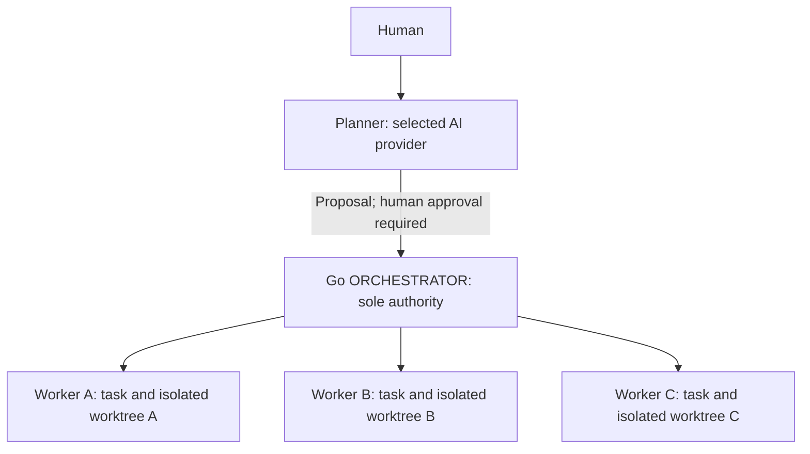

> **Looking for the quick start?** Use [setup.md](setup.md). This document preserves the detailed provider, manual-operation, recovery, and advanced workflow reference for users who need it.

---

# Multi-Agent Orchestrator — Advanced Setup and Manual Operations

This guide is for anyone who receives the repository link and wants to coordinate multiple coding agents on a local Git project.

The Go ORCHESTRATOR is the coordination authority. It manages enrollment, sessions, exclusive scopes, isolated Git worktrees, durable objective/task reservations, guarded execution, result evidence, and the human review gate. It does **not** automatically merge or deploy code.

> Current boundary: this is a local orchestration system. It is not an OS/container security sandbox and its locks are not a distributed multi-machine lock service.

## Quick start

1. Install Git and Go 1.24 or newer. Keep the orchestrator checkout beside your
   project repositories. The Go-version troubleshooting section below remains
   available if toolchain selection fails.
2. Install and authenticate at least one supported coding-agent CLI yourself:
   Codex, Claude Code or Gemini CLI. ORCHESTRATOR does not install agents, supply
   credentials, or silently test paid model calls.
3. Clone this repository:

   ```bash
   cd ~/Projects
   git clone https://github.com/eeyung1/multi-agent-orchestrator.git
   cd multi-agent-orchestrator
   ```

4. Run the regression suite:

   ```bash
   go test ./...
   ```

5. Start the Planner:

   ```bash
   go run ./cmd/planner
   # Or identify the target repository up front:
   go run ./cmd/planner --workspace ~/Projects/my-project
   ```

6. Choose the target repository, Planner and worker pool when prompted. A built-in
   installed provider does not require editing JSON. You can also select directly:

   ```bash
   go run ./cmd/planner --workspace ~/Projects/my-project --planner codex --workers codex,gemini --max-workers 3
   go run ./cmd/planner --list-providers
   ```

   Detection only inspects trusted absolute PATH entries, not authentication or
   version compatibility. It never executes a provider to probe availability.
   Relative/project-local executables and symlinks into projects are excluded.
   Missing/unavailable agents produce an error; install/authenticate them using
   their own documented setup rather than granting the model installation rights.

   A missing policy starts an explicit validation bootstrap. Choose the project's
   required checks (Go/Node/Python suggestions are based on file names), or enter
   a trusted executable plus a JSON argument array. Confirm the mandatory checks
   and optionally authorize a worktree preparation executable and JSON arguments.
   Fresh worktrees contain tracked files, so local dependencies such as
   `frontend/node_modules` must be prepared separately when needed. No install
   command is inferred or executed without authorization. Save preparation
   alongside validation in your user config if desired. No checks are silently
   omitted and nothing is executed during policy setup. Project instructions may
   require more gates than the suggested preset: use custom checks/policy for
   those repositories. Do not substitute a weak check to shorten onboarding.
7. Describe one objective. Approve genuine enrollment/legacy-authority decisions,
   context transmission and the concrete task/dependency plan. The model proposes;
   Go admits and enforces. Selected worker IDs become the permitted capabilities.
8. Review the consolidated exact-head evidence at `AWAITING_REVIEW`. Record a
   human approval or request changes. Merge and deployment remain separate,
   human-controlled actions.

Planner = conversation/reasoning. Go ORCHESTRATOR = deterministic authority.
Workers = assigned implementation. User = final review/integration authority.
Go handles scopes, claims, sessions, worktrees, generations and evidence.

Built-in workers leave edits for Go to check and commit on the local feature
branch. Codex uses read-only planning and workspace-write workers, without a
dangerous approval/sandbox bypass. Claude uses no tools for planning and
acceptEdits workers; Gemini uses plan mode for planning and a sandboxed auto_edit
worker. Provider permission denials, missing sandbox backends and incompatible
flags are reported rather than bypassed. This is still local orchestration,
not an OS/container sandbox provided by Go.

Restart the same command and select the saved objective. Its built-in selections
are restored; configuration/instruction/generation checks remain enforced and
existing assignments are never blindly relaunched. Explicit provider/pool changes
require a new authorization. Keep the same policy/concurrency overrides for a
resumed objective; policy drift fails closed.

Before live acceptance, ensure CLI authentication, Git author identity, meaningful
project validators and acknowledged ORCHESTRATOR enrollment. Legacy ownership is
reconciled explicitly. The automated tests use fake agents, not live paid calls.

## Connecting the Planner and Worker Agents

Here, “connect an agent” means configure a supported provider adapter and let the
Planner runtime invoke it. It does **not** mean attach an arbitrary chat or an
agent process that is already running elsewhere.

### Roles and authority

| Participant | What it does |
| --- | --- |
| Human | Chooses the objective, authorizes the plan and sensitive policy/recovery decisions, reviews evidence, and controls merge/deployment. |
| Planner | Discusses the objective, reasons over repository recon, proposes bounded tasks, and presents consolidated results through the supported Planner runtime. |
| Go ORCHESTRATOR | Sole coordination authority: admits objectives, assigns tasks, owns claims/generations, allocates worktrees, admits and supervises execution, runs validators, records authoritative results, and controls recovery state. Human recovery authorization is still required. |
| Worker | Receives one bounded assignment in its assigned worktree/scope and returns implementation or blocker information. It cannot acquire arbitrary work, grant itself authority, authorize recovery, merge, or deploy. |



The Go `cmd/planner` program provides the terminal interface and calls the Go
controller internally. There is no separate ORCHESTRATOR server to start or
network connection to configure for this workflow. The model supplies proposals;
it does not grant ownership, admit execution, validate results, or authorize
recovery. Workers receive assignments from Go and return through its supervised
execution path, rather than coordinating ownership directly with the Planner.

You manually install/authenticate providers, choose roles and limits, configure
real project checks/preparation, and authorize the plan. After authorization,
Go automatically acquires eligible tasks, allocates worktrees, launches and
supervises workers, validates output, and collects evidence. Reviewing the
results and integrating them remain your responsibility.

### Select the Planner provider

From the orchestrator checkout, run:

```bash
go run ./cmd/planner --workspace ~/Projects/my-project
```

The runtime discovers supported CLIs on trusted absolute PATH entries and offers
interactive Planner and worker-pool choices. The built-ins are `codex` (Codex),
`claude` (Claude Code), and `gemini` (Gemini CLI); all three support both roles.
Discovery checks executable availability without launching the CLI, checking its
version, authenticating, or making a model request. Project-local executables,
relative PATH entries and symlinks into projects are excluded. To inspect the
available choices without starting an objective:

```bash
go run ./cmd/planner --list-providers
```

Select interactively or pass `--planner codex`, `--planner claude`, or
`--planner gemini`. `Planner activated: Codex` means the Codex adapter and its
executable have been selected and resolved. It does not prove authentication or
attach your current Codex conversation. After Go gathers bounded recon and you
authorize sending it, the runtime launches a new provider invocation to request
a proposal. It may ask bounded clarification questions; this is not an imported
chat session. The final consolidated report comes from Go's recorded evidence.

Built-in selections are recorded with the admitted objective and restored when
you resume it. They are not a promise that every new objective will use the same
choices. Policy saving during first-run setup saves the authorized policy; do
not rely on it to save a global Planner/worker selection. Changing a saved
objective's provider/pool requires new authorization and is not a way to bypass
its existing policy checks.

There is no built-in `--model` selector. Built-in invocations use the model
selected by that CLI's applicable settings/defaults, not an existing chat's
context. A trusted custom planning CLI or configured chat-completion endpoint
can select other providers/models through the
[advanced configuration](#configure-custom-providers-and-policy). Those are
planning adapters, not a way for arbitrary processes to register themselves.

### Enable worker providers

Install and authenticate each desired CLI under the user/environment that will
run Planner. Authentication belongs to that provider's CLI; keep credentials
out of `state.json`, `agentmeeting.md`, and the other coordination ledgers.
ORCHESTRATOR does not install providers or log you in.

For example, select Claude for planning and enable Codex and Gemini workers:

```bash
go run ./cmd/planner --workspace ~/Projects/my-project --planner claude --workers codex,gemini --max-workers 3
```

For a trusted personal config, the equivalent role/concurrency **fragment** is:

```json
{
  "planner": {"adapter": "claude"},
  "workers": {
    "codex": {"adapter": "codex"},
    "gemini": {"adapter": "gemini"}
  },
  "max_workers": 3
}
```

Merge this fragment with your real authorized validation/preparation policy; it
is not a complete standalone policy. Use `--config /absolute/path/planner.json`
to select a trusted config. Built-in worker keys must match their adapter IDs;
their executable/argument vectors are defined in Go and cannot be overridden by
model output. A requested unavailable provider fails with an error rather than
silently installing or substituting another one. Discovery can succeed while
authentication or CLI compatibility later fails during invocation.

Each proposed task selects a `capability` from the configured worker keys. Check
the displayed `worker=...` for each task before approving the plan. Installing
Gemini alone does not make it an eligible worker: include `gemini` in the pool
or trusted `workers` config. Enabling two providers does not guarantee tasks
will be evenly divided between them; the approved task capability determines
which adapter Go invokes.

Custom workers use the existing `program`/`args` configuration and must implement
the worker protocol described in the advanced section. An HTTP planning endpoint
does not supply an HTTP worker adapter automatically. Do not point a custom
worker at an arbitrary interactive command and assume it can consume an
assignment.

### Parallel assignments and max_workers

`"max_workers": 3`, or `--max-workers 3`, permits up to three eligible assignments
to execute concurrently. The default is three; the supported range is 1–16.
Each slot covers preparation, worker execution, validation, and collection. It
is a concurrency limit, not a count of already-running agents to attach.

| Independent task | Managed worker process | Isolated branch | Isolated worktree |
| --- | --- | --- | --- |
| Task A | Agent A | Branch A | Worktree A |
| Task B | Agent B | Branch B | Worktree B |
| Task C | Agent C | Branch C | Worktree C |

These are illustrative names; Go generates the actual assignment identities and
paths. Three workers do not share one editable checkout or own the same files.
One configured provider can supply all three processes: use
`--workers codex --max-workers 3`, not repeated `codex` entries in the pool.

Dependencies, scope conflicts/claims, unavailable prerequisite results, or fewer
eligible tasks reduce actual concurrency. Independent overlapping scopes are
not admitted as parallel work. Adding providers or increasing the limit cannot
make dependent tasks independent. Existing assigned work is not blindly
relaunched after a restart.

### From provider selection to reviewed results

1. Clone/configure the orchestrator and keep the target Git project separate.
2. Install and authenticate the provider CLIs you want to use.
3. Start Planner with `--workspace` pointing to the target project.
4. Select the Planner provider and worker pool; authorize enrollment and trusted
   validation/preparation policy when required.
5. Go gathers bounded repository recon. With your transmission approval, the
   Planner provider reasons over it and proposes tasks.
6. Review and explicitly authorize the objective/task plan, including each scope,
   dependency, worker capability, acceptance criterion, and check.
7. Go ORCHESTRATOR admits and records the authoritative objective/tasks.
8. The scheduler finds eligible pending tasks whose prerequisites permit work.
9. For each task, Go uses its approved capability to select the configured worker
   adapter; it does not ask a model to invent an executable.
10. Go acquires ownership and binds the assignment to its isolated branch/worktree,
    session, claim token, and generation.
11. After any authorized worktree preparation, Go launches a worker subprocess
    inside that worktree with bounded `WorkerContext` JSON on stdin. It contains
    the task/scope, assignment identity, instructions, and prerequisite evidence.
12. Other eligible independent assignments can run concurrently up to `max_workers`.
13. Go supervises execution with guards, timeouts and heartbeats. Built-in workers
    leave edits for Go's ownership checks and local feature-branch commit.
14. Go checks the committed, clean, scoped output and runs the configured trusted
    validators against that exact HEAD.
15. Go records validation evidence/results in durable coordination/structured state.
    A blocker is preserved for authorized recovery, not silently treated as success.
16. The Planner terminal presents the consolidated report from those results.
17. You inspect evidence and record approval, request changes, or leave review open.
18. Integration, merge and deployment remain separate human-controlled actions.

### Supported provider-to-role examples

All of these combinations use current built-in adapters, provided the named
CLIs are installed and authenticated:

| Planner | Enabled worker providers | Selection flags |
| --- | --- | --- |
| Codex | Codex | `--planner codex --workers codex` |
| Claude Code | Codex + Gemini CLI | `--planner claude --workers codex,gemini` |
| Gemini CLI | Claude Code + Codex | `--planner gemini --workers claude,codex` |

Append the flags to `go run ./cmd/planner --workspace ~/Projects/my-project`,
with `--max-workers 3` if desired. For mixed pools, review which capability each
proposed task actually uses. No provider/model gains ORCHESTRATOR authority
because it is selected as Planner.

### Independently running agents versus managed agents

- An **independent chat/process** has its own conversation and lifecycle. It does
  not join a managed objective just because it is open in the same project.
- A **configured provider CLI** is an available executable/adapter that Go is
  authorized to invoke. Selecting it does not attach to an existing process.
- A **managed worker** is a new subprocess Go launches for an admitted assignment,
  with its worktree, bounded context, guards and recorded execution evidence.

Arbitrary existing live processes cannot currently attach as Planner or workers
to this managed workflow, import their chat histories, or join an objective
after starting independently. The lower-level manual activation/session commands
are a separate interface; registering a session there does not attach that
process to `cmd/planner` scheduling or supervision.

To run several agents, configure the provider pool, set `max_workers`, and approve
a plan with independent bounded tasks. Let Go launch them. Do not open several
independent chats in the same checkout and manually copy claims or tokens to
simulate managed workers. Users normally do not need to manage session IDs,
tokens, generations, or worktree internals themselves.

### Troubleshoot agent connections

Check only the providers you intend to use, from the same environment as Planner:

```bash
which codex
codex --version
which claude
claude --version
which gemini
gemini --version
go run ./cmd/planner --list-providers
```

The version commands are manual diagnostics, not discovery actions performed by
ORCHESTRATOR. Finding a binary or printing its version does not establish that
it is authenticated. Complete authentication using the provider's own CLI setup.

| Symptom | What to check/do |
| --- | --- |
| Executable not found or excluded | Install the CLI on a trusted absolute PATH outside the target/orchestrator projects; inspect `--list-providers`. Do not bypass trust checks with a project-local wrapper. |
| Provider starts but authentication/permissions/flags fail | Check that CLI's login, version and supported execution environment under the same user. The runtime does not bypass permission or sandbox failures. |
| Installed provider is not used as a worker | Include its ID in `--workers` or the trusted `workers` map, and inspect each proposed task's capability. |
| Only one assignment runs | Check for `max_workers = 1`, dependencies, overlapping scope/claims, or only one eligible task. A larger pool alone does not create parallel tasks. |
| No eligible tasks | Inspect task status, prerequisite results and blockers in the consolidated report. Completed/assigned tasks are not new pending work; divergent prerequisite branches can require human integration. |
| Policy/recon requires authorization | Review the reported policy or instruction change and follow the explicit authorization flow. Do not edit recorded digests or silently remove checks. |
| Task is BLOCKED | Review the blocker/preserved branch and follow [BLOCKED recovery](#recover-a-blocked-planner-assignment). Do not edit ledgers or delete claims/worktrees to retry. |

### First real parallel-agent run

Use a new disposable project with Git author identity configured. The example
uses Go's standard library so local package installation is unnecessary. These
commands create the demo; run them yourself in a new directory:

```bash
mkdir -p ~/Projects/agent-demo
cd ~/Projects/agent-demo
git init -b main
go mod init example.org/agent-demo
printf '# Agent connection demo\n' > README.md
git add go.mod README.md
git commit -m "Seed agent demo"
cd ~/Projects/multi-agent-orchestrator
go run ./cmd/planner --workspace ~/Projects/agent-demo --planner codex --workers codex --max-workers 3
```

Install/authenticate Codex first, or substitute another supported built-in for
both role flags. Authorize enrollment and meaningful Go-test/diff-check policy
when prompted. This standard-library example needs no worktree preparation.
Describe an objective such as:

> Create three independent Go packages, with one task per directory and no
> dependencies between tasks: `alpha/` implements and tests `Add(a, b int) int`;
> `beta/` implements and tests `Reverse(s string) string` for Unicode strings;
> `gamma/` implements and tests `IsEven(n int) bool`. Each task owns only its
> package directory. Leave the root README and go.mod unchanged. Use the codex
> worker capability for all three tasks and run the authorized Go tests and diff
> check for each result. Leave all results for my review; do not merge or deploy.

Review the proposal before authorization: it should contain three disjoint
scopes and no dependency edges. If it does not, answer no and restart with a
clarified objective; rejecting the plan ends that invocation rather than opening
an interactive replanning loop. Selecting one provider is intentional: three
separate Codex worker processes can demonstrate concurrency without requiring
three accounts or three different providers. For a mixed-provider test, enable
the other IDs and request/review the corresponding capabilities instead.

Watch these signals; wording beyond the quoted messages is not a live-event API:

| Stage | What you can observe |
| --- | --- |
| Planner selected | `Planner activated: Codex` confirms adapter selection, not a successful model call. |
| Worker enabled | With the explicit pool above, `Worker capability enabled: codex (Codex)` confirms availability to the plan, not a running worker. |
| Plan approval | Proposed tasks show `scope=`, `dependencies=`, `checks=`, and `worker=`; the runtime asks `Authorize this plan and its configured worker/validation commands? [y/N]`. |
| Scheduling | `ORCHESTRATOR is scheduling eligible work and collecting evidence. Existing assignments will not be relaunched.` marks entry to managed execution. |
| Acquisition/worktrees | Read-only inspection of `multi-agent-orchestrator/state.json` shows assignment status and branch/worktree identities; `git -C ~/Projects/agent-demo worktree list` lists created worktrees. |
| Concurrent execution | Independent tasks may have concurrent assignments; use an OS process monitor to observe actual overlapping worker processes. Multiple preserved worktrees alone do not prove simultaneous execution. |
| Supervision/validation | `agentmeeting.md` contains operational status/heartbeats; `resolution.md` contains execution evidence. The final report records checks, exact HEADs and blockers. |
| Final review | Successful collection reaches `AWAITING_REVIEW` and the human review prompt. Inspect the branches/evidence before approving. Approval does not merge them. |

There is no built-in per-worker live launch/progress dashboard. The terminal may
remain quiet while children execute; use the read-only evidence above rather
than assuming a missing live message means no work started. Do not edit those
files. Real model calls can incur provider charges, and tasks can finish too
quickly to observe overlap. This demo is live acceptance, unlike the automated
regression suite's fake providers.

### Current connection limits

This is local orchestration, not an OS/container sandbox; its filesystem locks
are not distributed multi-host locks. Provider executables remain trusted local
programs. There is no arbitrary live-agent attachment, worker self-authorization,
or automatic merge/deployment. The Planner is the reasoning interface and Go
remains the sole coordination authority. The human retains final review and
integration authority, including explicit recovery authorization.

## Advanced / Custom Providers

This section is optional for HTTP providers, custom CLI adapters or handwritten
policy. Built-in provider selection uses the quick-start flow above. Validators,
required gates, scope ceilings, timeouts and concurrency remain trusted policy.

Install Git, Go 1.24+, and your chosen coding-agent CLI. Keep one orchestrator
checkout beside your target repositories, then verify it:

```bash
cd ~/Projects/multi-agent-orchestrator
go test ./...
```

Planner = conversational/reasoning layer. Go ORCHESTRATOR = deterministic
authority/enforcement. Workers = implementation agents. You = final
review/integration/merge/deployment authority.

### Configure custom providers and policy

Copy [examples/planner.json](examples/planner.json) to a trusted personal
configuration file. The default location on Linux is
`~/.config/orchestrator/planner.json`; `--config /absolute/path/planner.json`
selects another file. Executable policy is not automatically loaded from the
target project.

Edit the example for your environment:

- `planner`: your installed model's chat-completion endpoint/model, or a
  proposal-only CLI adapter (`program`/`args`). For hosted credentials set
  `api_key_env` to an exported variable's name; never put key values in JSON.
- `workers`: capability names mapped to custom executable/argument vectors, or
  a built-in ID such as `"codex": {"adapter": "codex"}`. A built-in's arguments
  and executable cannot be redefined. Custom definitions remain a separate path.
  `{prompt}` is the complete assignment as one argument. Stdin also receives JSON.
- `validators`: named executable/argument vectors for the project's real tests,
  builds and checks. Replace Go examples for non-Go projects. The model can
  select these names but cannot invent executable validation commands.
- `required_validators`: checks that every task must run. Use this for mandatory
  repository test/build gates; a proposal cannot omit these configured checks.
- `worktree_preparation`: optional ordered array of structured commands, e.g.
  `[{"Program":"npm","Args":["--prefix","frontend","ci"]}]` for a project
  that needs frontend dependencies. Choose commands for your project; there is
  no default. Executables must resolve from trusted absolute PATH entries or
  trusted absolute paths; project-local executables/symlinks are excluded.
  Commands run once per new assignment in its exact isolated worktree before
  the worker, using execution guards, heartbeats and timeouts. Failure blocks
  the assignment without launching a worker. Successful preparation is retained
  during bounded worker repairs. Model proposals cannot define these commands.
- `allowed_scopes`: optional product-scope ceiling. `.` permits proposals across
  the repository; actual tasks must claim bounded product paths, excluding
  controller/Git metadata. You approve the concrete plan before execution.
- `max_workers`, timeouts, heartbeat interval and `repair_attempts`: operational
  limits. Repairs apply only to this controller's stopped child in the same
  assignment, never an absent writer or expired heartbeat.

The example model name is a placeholder. Configure your provider before running;
there is no bundled live model or credential. Use trusted adapters: this runtime
does not sandbox executables or strip their inherited environment.

### Describe one objective

```bash
go run ./cmd/planner --workspace ~/Projects/my-project
# Or select an alternate trusted configuration:
go run ./cmd/planner --workspace ~/Projects/my-project --config /path/planner.json
```

The Planner checks enrollment first. For a native repository it asks for explicit
ORCHESTRATOR enrollment authorization. Legacy ownership/conflicting instructions
require reconciliation; the Planner will not delete tooling or bypass ambiguity.

It asks what you want accomplished, inventories bounded project context, asks
before sending that context to the configured provider, and displays proposed
tasks, scopes, dependencies, acceptance and configured checks for confirmation.
Empty input or silence never authorizes enrollment, execution or review.

After confirmation, ORCHESTRATOR handles sessions, tokens, generations,
worktrees, dispatch, heartbeats, bounded repair, validation and collection. You
do not need to copy these values between commands. Go commits checked built-in
worker output; custom workers retain their explicit local-commit contract.
This version does not automatically push product branches or create product PRs.

### Resume and review

Start the same command again and select the saved objective by its description.
The controller reconstructs existing tasks/results/review state. It never
relaunches assigned work just because a process disappeared. Unknown writers,
exhausted repair, scope expansion, conflicting instructions and divergent
prerequisite branches become concrete decision questions while independent
eligible work continues.

For a BLOCKED task, follow [Recover a BLOCKED Planner assignment](#recover-a-blocked-planner-assignment)
below. Recovery requires an explicit human decision through Planner.

The consolidated report contains completed/incomplete tasks, branches, exact
HEADs, validation evidence, local artifacts, blockers, limitations and next action.
When all task results are collected it reaches `AWAITING_REVIEW`. The interactive
human can record `approve`, `changes`, or `leave` for review status.

**Approval never means merge or deployment.** Inspect the branches/evidence and
perform integration through your normal authorized human workflow. The tests use
fake providers/CLIs; a real multi-agent repository acceptance run is still required.

Read [docs/planner-agent.md](docs/planner-agent.md) for provider contracts,
recovery boundaries and limitations, including the current single scope per task.

## Advanced / Manual ORCHESTRATOR commands

The detailed installation, enrollment and individual lifecycle operations below
are useful for diagnostics and advanced integrations. They are not required for
the normal Planner workflow above.

## 1. Requirements

Install:

- Git
- Go 1.24 or newer
- one or more coding-agent CLIs you want to run (Codex, Claude Code, OpenCode, etc.)
- access to the target Git repository

Verify:

```bash
git --version
go version
```

### If your Go version is too old

This project requires **Go 1.24 or newer**. On some systems, especially machines
using an older distro/package-manager Go installation, commands such as
`go test ./...` or `go run ./cmd/orchestrator` may fail with messages similar to:

```text
go: downloading go1.24...
go: toolchain not available
```

or:

```text
go: download go1.24: toolchain not available
```

First check what Go executable and version your shell is actually using:

```bash
which go
go version
go env GOTOOLCHAIN
```

If `go version` is below 1.24, install a current Go release from the official Go
downloads page for your operating system. After installation, open a new terminal
and verify that the new executable appears first on `PATH`:

```bash
which go
go version
```

The version must report Go 1.24 or newer before continuing.

#### Linux without sudo: install Go in your home directory

If you cannot replace the system Go installation, install a current Go toolchain
under your own home directory. Download the appropriate archive from the official
Go downloads page, then use the downloaded filename below:

```bash
rm -rf ~/.local/go
mkdir -p ~/.local

tar -C ~/.local -xzf ~/Downloads/go1.24.x.linux-amd64.tar.gz

echo 'export PATH="$HOME/.local/go/bin:$PATH"' >> ~/.bashrc
export PATH="$HOME/.local/go/bin:$PATH"

which go
go version
```

Replace `go1.24.x.linux-amd64.tar.gz` with the actual current archive you
downloaded and use the architecture appropriate for your machine.

If `which go` still shows something such as `/usr/bin/go`, your old system Go
is still taking precedence. Ensure the new Go bin directory is at the **front** of
`PATH`, then start a new shell:

```bash
source ~/.bashrc
hash -r
which go
go version
```

#### Toolchain auto-download setting

With a sufficiently recent bootstrap Go installation, Go can select newer
toolchains automatically. Check:

```bash
go env GOTOOLCHAIN
```

The normal setting is `auto` (or a version with `+auto`). If the user previously
disabled automatic toolchain selection, restore it:

```bash
go env -w GOTOOLCHAIN=auto
```

However, changing `GOTOOLCHAIN` is **not a substitute for fixing an obsolete or
broken Go installation**. If automatic download still reports `toolchain not
available`, install Go 1.24+ directly and confirm `go version` before retrying.

Finally:

```bash
cd ~/Projects/multi-agent-orchestrator
go test ./...
```

Do not continue with repository enrollment until these tests pass.

## 2. Recommended folder layout

Keep the orchestrator beside target projects, not inside them:

```text
~/Projects/
├── multi-agent-orchestrator/
├── project-a/
└── project-b/
```

Create the parent folder and clone:

```bash
mkdir -p ~/Projects
cd ~/Projects

git clone https://github.com/eeyung1/multi-agent-orchestrator.git
git clone https://github.com/OWNER/PROJECT.git my-project
```

Verify the orchestrator itself:

```bash
cd ~/Projects/multi-agent-orchestrator
go test ./...
```

All tests should pass before using it on another repository.

## 3. Preflight the target repository

Always inspect coordination authority before enrolling a project:

```bash
cd ~/Projects/multi-agent-orchestrator

go run ./cmd/orchestrator \
  --workspace ~/Projects/my-project \
  --preflight
```

### New repository with no competing coordinator

If preflight reports a native repository with no competing coordination mechanism, enroll it:

```bash
go run ./cmd/orchestrator \
  --workspace ~/Projects/my-project \
  --enroll \
  --enrollment-disposition NATIVE \
  --enrollment-provenance "Repository owner authorized ORCHESTRATOR coordination"
```

### Repository that already has agent coordination

Do **not** blindly enroll it. Reconcile first:

```bash
go run ./cmd/orchestrator \
  --workspace ~/Projects/my-project \
  --reconcile-legacy
```

If `ambiguous` contains entries, resolve them before migration. Active/WORKING legacy claims must not be silently stolen or released.

After the repository owner has fenced the old ownership writer, reconciled instructions, and confirmed historical ownership, migration can be authorized:

```bash
go run ./cmd/orchestrator \
  --workspace ~/Projects/my-project \
  --migrate-legacy \
  --acknowledge-legacy-history \
  --enrollment-provenance "Owner approved migration after legacy coordination reconciliation"
```

Do not use this acknowledgement to bypass unresolved ownership.

## 4. What appears in the target repository

The runtime creates local coordination state such as:

```text
my-project/
├── multi-agent-orchestrator/
│   ├── state.json
│   ├── agentmeeting.md
│   ├── coordination.md
│   └── resolution.md
└── .agent-worktrees/
```

`state.json` is the structured authority state. The Markdown files are readable coordination/evidence ledgers.

These runtime directories normally should **not** be committed to the target project's product branch. Add appropriate ignore rules for your repository if needed.

## 5. Two ways to coordinate work

### A. Direct/manual assignment

For a small test, start independent assignments directly:

```bash
go run ./cmd/orchestrator \
  --start \
  --workspace ~/Projects/my-project \
  --agent Codex \
  --role coding-agent \
  --feature backend-auth \
  --scope backend/auth \
  --token codex-backend-auth \
  --base main
```

The runtime returns the session, claim, branch and isolated worktree.

Start another agent with a non-overlapping scope:

```bash
go run ./cmd/orchestrator \
  --start \
  --workspace ~/Projects/my-project \
  --agent Claude-Code \
  --role coding-agent \
  --feature frontend-login \
  --scope frontend/login \
  --token claude-frontend-login \
  --base main
```

Invariant:

```text
one feature → one owner → one branch → one isolated worktree
```

Never point multiple agents at the same worktree.

### B. Objective-plan acquisition

For less manual assignment, define an objective plan. Example `plan.json`:

```json
{
  "ID": "auth-hardening",
  "Objective": "Harden authentication and document the behavior",
  "Tasks": [
    {
      "ID": "backend-auth",
      "Feature": "backend-auth",
      "Scope": "backend/auth",
      "Priority": 20
    },
    {
      "ID": "auth-tests",
      "Feature": "auth-tests",
      "Scope": "tests/auth",
      "DependsOn": ["backend-auth"],
      "Priority": 10
    },
    {
      "ID": "auth-docs",
      "Feature": "auth-docs",
      "Scope": "docs/auth",
      "Priority": 5
    }
  ]
}
```

Acquire the next eligible task:

```bash
go run ./cmd/orchestrator \
  --workspace ~/Projects/my-project \
  --acquire-next \
  --plan-file ./plan.json \
  --agent Codex \
  --role coding-agent \
  --base main
```

Run the same command for additional workers. The scheduler persists the objective/tasks, reserves eligible work under structured state, prevents legitimate duplicate acquisition, creates assignment generations, and delegates the normal isolated-worktree start.

Save the returned JSON. It contains the task, session, token, branch, worktree, attempt and assignment generation needed for later result collection.

## 6. Give each agent its exact worktree

The portable protocol is:

```text
~/Projects/multi-agent-orchestrator/agent_activation_prompt.md
```

Give each worker:

- the activation protocol;
- its returned session ID;
- assigned task/feature;
- exact scope;
- exact worktree;
- acceptance criteria.

Open/run that coding agent **inside the returned worktree**, not the primary checkout.

An agent must never infer ownership from silence or edit another assignment's scope.

## 7. Heartbeats and guarded execution

Refresh a long-running session:

```bash
go run ./cmd/orchestrator \
  --workspace ~/Projects/my-project \
  --session SESSION_ID \
  --heartbeat
```

The runtime can launch a CLI agent inside an already-owned worktree:

```bash
go run ./cmd/orchestrator \
  --execute \
  --workspace ~/Projects/my-project \
  --worktree WORKTREE_PATH \
  --session SESSION_ID \
  --agent-program AGENT_EXECUTABLE \
  --agent-arg ARGUMENT \
  --timeout 30m
```

Use repeatable `--agent-arg` flags rather than combining an untrusted command into a shell string.

Execution is ownership/lifecycle guarded, but it is not an OS sandbox.

## 8. Validate normal/manual assignments

For a directly started assignment, use the target project's real validation command.

Go example:

```bash
go run ./cmd/orchestrator \
  --complete \
  --workspace ~/Projects/my-project \
  --worktree WORKTREE_PATH \
  --session SESSION_ID \
  --feature FEATURE_NAME \
  --token CLAIM_TOKEN \
  --validate-program go \
  --validate-arg test \
  --validate-arg ./...
```

Node example:

```bash
go run ./cmd/orchestrator \
  --complete \
  --workspace ~/Projects/my-project \
  --worktree WORKTREE_PATH \
  --session SESSION_ID \
  --feature FEATURE_NAME \
  --token CLAIM_TOKEN \
  --validate-program npm \
  --validate-arg test
```

Failed validation moves the work to BLOCKED and retains ownership. Do not give that scope to another worker merely because validation failed.

## 9. Collect objective-task results

For objective-plan assignments, preserve the scheduler output. After the agent has implemented, tested, committed and pushed its branch, collect the exact result:

```bash
go run ./cmd/orchestrator \
  --workspace ~/Projects/my-project \
  --collect-result \
  --objective-id auth-hardening \
  --task-id backend-auth \
  --session SESSION_ID \
  --token CLAIM_TOKEN \
  --assignment-generation ASSIGNMENT_GENERATION \
  --worktree WORKTREE_PATH \
  --result-branch BRANCH_NAME \
  --validation-evidence "go test ./...: PASS" \
  --artifact "PR #123" \
  --limitation "No production deployment performed"
```

Repeat `--artifact`, `--blocker`, and `--limitation` when needed.

Result collection resolves the exact Git HEAD from the assigned worktree and rejects stale session/generation publication.

## 10. Human review gate

When every task in an objective has a collected result, the objective becomes:

```text
AWAITING_REVIEW
```

Build the consolidated review package:

```bash
go run ./cmd/orchestrator \
  --workspace ~/Projects/my-project \
  --review-package \
  --objective-id auth-hardening
```

The repository owner/reviewer can then record:

```bash
go run ./cmd/orchestrator \
  --workspace ~/Projects/my-project \
  --objective-id auth-hardening \
  --review-decision APPROVED \
  --review-actor "Repository Owner"
```

or:

```bash
go run ./cmd/orchestrator \
  --workspace ~/Projects/my-project \
  --objective-id auth-hardening \
  --review-decision CHANGES_REQUESTED \
  --review-actor "Repository Owner"
```

**APPROVED does not merge, push, or deploy anything.** Integration remains under the repository's authorized human workflow.

## 11. GitHub integration

Each agent should normally:

```text
inspect → implement → test → commit → push feature branch → open focused PR
```

Then:

```text
CI → verify exact PR head → human review → authorized merge
```

Do not treat mergeability or an old successful CI run as proof that the current PR head passed.

## 12. End-to-end execution option

After understanding the lifecycle, a direct assignment can be composed into one guarded command:

```bash
go run ./cmd/orchestrator \
  --run \
  --workspace ~/Projects/my-project \
  --agent Codex \
  --role coding-agent \
  --feature feature-name \
  --scope path/to/scope \
  --token unique-token \
  --base main \
  --agent-program AGENT_EXECUTABLE \
  --agent-arg ARGUMENT \
  --validate-program go \
  --validate-arg test \
  --validate-arg ./... \
  --timeout 30m
```

The exact agent executable/arguments depend on the coding tool installed by the user.

## 13. Recommended first test

Use a disposable/small repository with two independent tasks.

Confirm:

1. preflight/enrollment succeeds;
2. two agents receive different sessions/worktrees;
3. overlapping scopes are rejected;
4. both agents can work independently;
5. validation/evidence is recorded;
6. objective results reach `AWAITING_REVIEW`;
7. the review package contains exact heads and evidence;
8. nothing merges without the authorized human.

Only then increase the number of simultaneous workers.

## 14. Troubleshooting

**"repository is not enrolled"** — run preflight and enroll/migrate correctly.

**legacy authority is ambiguous** — do not bypass it. Reconcile project instructions, active claims and old ownership writers first.

**overlapping scope/claim rejected** — another assignment owns that path or a parent/child path. Choose independent work or perform an authorized handoff.

**task/session is BLOCKED** — inspect the blocker and preserved evidence. For Planner-managed tasks, use the recovery workflow below; do not steal the scope or manually change coordination state.

**wrong worktree** — use the exact worktree returned by the scheduler/start command.

**state/runtime folders show as untracked** — do not accidentally commit them to product code; add repository-appropriate ignore rules.

**Go tests fail in this repository** — stop and resolve that before using the runtime for production work.

### Recover a BLOCKED Planner assignment

A BLOCKED assignment retains ownership until an authorized recovery retires it.
Its preserved branch and isolated worktree are evidence from the failed attempt;
they may contain implementation work, commits, or generated files worth reviewing.

- Do not manually edit `multi-agent-orchestrator/state.json` or
  `multi-agent-orchestrator/agentmeeting.md` to retry a task.
- Do not delete claims, reuse or alter claim tokens, or manually mark a session
  BLOCKED or HANDOFF.
- Do not delete the preserved worktree or branch just to retry.

#### Normal recovery

1. From your orchestrator checkout, start Planner against the target workspace:

   ```bash
   go run ./cmd/planner --workspace ~/Projects/my-project
   ```

2. Select the existing objective to resume. Keep its trusted configuration and
   concurrency overrides as described under [Resume and review](#resume-and-review).
3. Planner identifies each BLOCKED task and displays its attempt, blocker, and
   preserved branch. Review the blocker and any work that needs human inspection.
   For missing toolchains or local dependencies, consult the existing
   [Go toolchain troubleshooting](#if-your-go-version-is-too-old) and
   [worktree preparation policy](#configure-custom-providers-and-policy) guidance
   before retrying. Recovery does not authorize a new installation command.
4. Planner asks: `Authorize recovery of blocked task <task> with a fresh assignment? [y/N]`.
   Explicitly answer `yes` only after reviewing the blocker and resolving the
   underlying issue. Enter, silence, or a refusal does not authorize recovery.
5. Go ORCHESTRATOR verifies and safely retires the exact old assignment, releases
   that session's claims, preserves its assignment history and branch/worktree,
   and returns the task to PENDING.
6. When eligible, a subsequent acquisition creates a fresh attempt with a new
   assignment generation, session, claim token, and isolated branch/worktree.

Users normally do not need to know or manually manage session IDs, claim tokens,
generations, or worktree internals. Planner presents the decision; Go performs
the ownership changes.

#### Historical BLOCKED/WORKING split

An interrupted or historical failure path can leave structured scheduler state
saying BLOCKED while its older operational session still says WORKING. Do not
manually reconcile those files. Use the same explicit recovery flow above.

Before retiring a WORKING session, ORCHESTRATOR verifies that its ownership is
the exact assignment represented by the structured BLOCKED task. Checks include:

- objective/task identity and the exact assignment generation;
- session identity, claim token and operational claim ownership;
- the assigned branch/worktree and the claim's feature/scope;
- no replacement/newer assignment or conflicting active ownership;
- explicit human recovery authorization.

If those checks do not match, recovery fails closed. Inspect the reported
mismatch and resolve its cause rather than editing the ledgers or forcing a retry.

#### Safe retry after interruption

Recovery spans separate durable coordination and structured-state writes. An
interruption can leave the task BLOCKED with its old session already HANDOFF;
this BLOCKED/HANDOFF boundary is designed for safe retry. Restart Planner, resume
the same objective, and review and explicitly authorize recovery again if asked.
Do not manually change state or restore old claims. Completed recovery or a
replacement assignment is fenced against reuse of an old authorization.

#### When to stop

Do not force recovery when another/newer assignment owns the task, when
generation/session/token identity does not match, when the preserved branch
contains work needing human review first, or when Planner/ORCHESTRATOR reports
an authority or reconciliation error. Inspect the blocker and resolve the
underlying issue first. A WORKING status or old heartbeat alone does not prove
that a writer has stopped or authorize taking over its work.

Go ORCHESTRATOR remains the sole coordination authority. Planner is the
reasoning/conversational interface; workers cannot self-authorize recovery.
The user retains final review and merge/deployment authority. This is local
orchestration, not an OS/container sandbox, and local filesystem coordination
is not a distributed multi-host lock.

## 15. Updating the orchestrator

Because one clone can serve multiple target projects:

```bash
cd ~/Projects/multi-agent-orchestrator
git switch main
git pull --ff-only origin main
go test ./...
```

Do not overwrite a target project's structured state simply because the orchestrator code was updated.

## 16. What this release does and does not guarantee

It provides:

- single acknowledged local coordination authority;
- exclusive hierarchical scopes;
- isolated Git branches/worktrees;
- durable objective/task reservations;
- assignment attempt/generation fencing;
- guarded execution and heartbeats;
- result/evidence collection;
- consolidated human review;
- human-controlled integration.

It does not provide:

- automatic discovery of already-open coding-agent windows;
- a container/VM security boundary;
- distributed locking across different machines;
- automatic GitHub merge/deployment;
- proof that an agent's code is correct merely because it completed.

## Core mental model

```text
You define the objective
        ↓
ORCHESTRATOR owns coordination
        ↓
agents receive isolated eligible work
        ↓
agents implement + validate + push
        ↓
results/evidence are collected
        ↓
AWAITING_REVIEW
        ↓
you approve or request changes
        ↓
authorized GitHub integration
```

The activation prompt teaches the protocol. The Go runtime enforces local coordination. Git/GitHub remain the integration boundary.
